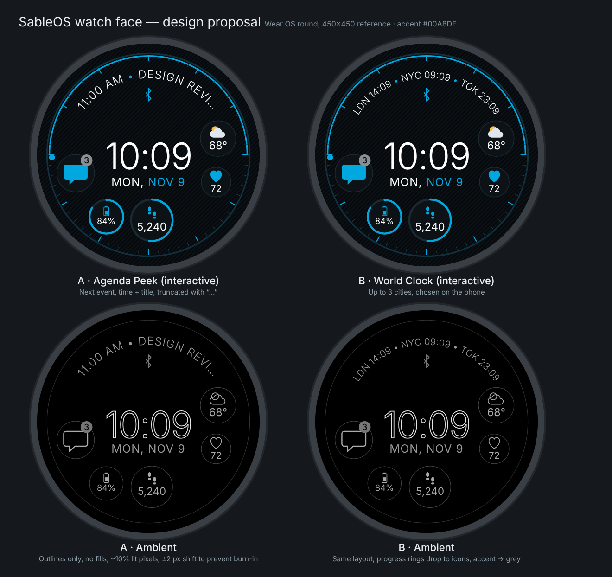

# Sable Watch

[](https://github.com/aimindseye/sable-watch/actions/workflows/android.yml)
[](https://github.com/aimindseye/sable-watch/actions/workflows/security.yml)
[](https://sonarcloud.io/summary/new_code?id=aimindseye_sable-watch)
[](LICENSE)
[](docs/GETTING_STARTED.md)
[](docs/DESIGN.md#phone-builds)

A BlackBerry 10-style watch face for Wear OS, and its phone companion, for [SableOS](https://github.com/aimindseye/zinwaq25-sableos). The face shows the time and date in the middle, five round complications (messages, weather, heart rate, battery and steps), and a curved top arc that shows either your next event (Agenda Peek) or three cities' times (World Clock).



## The apps

| App | Runs on | Package | What it is |
| --- | --- | --- | --- |
| Sable watch face | Watch | `io.github.aimindseye.sablewatch.face` | The face, in [Watch Face Format](https://developer.android.com/training/wearables/wff): XML and images, no code. Wear OS draws it |
| Sable Watch (watch) | Watch | `io.github.aimindseye.sablewatch` | Complication sources the face uses. Today: Sable World Clock |
| Sable Watch (phone) | Phone | `io.github.aimindseye.sablewatch` | The companion: cities, agenda source, sync. Two builds: `sable` for SableOS and `generic` for any Android phone |

The watch app and the phone app share one package name on purpose: the Wear OS Data Layer only connects apps with the same package name and signing key.

## Status

- **Watch face:** layout, ambient mode and all six slots. Validated against the Watch Face Format v1 schema in CI.
- **Sable World Clock:** works on the watch on its own (London, New York, Tokyo for now). Choosing cities on the phone comes next.
- **Phone app:** home screen only. The rest waits on the pairing test between the Galaxy Watch 7 and the Zinwa Q25 (SableOS uses microG, and Wear OS pairing normally needs Google Play services).

## Documentation

- [Getting started on Windows](docs/GETTING_STARTED.md): Android Studio, the Wear OS emulator, and a Galaxy Watch over Wi-Fi.
- [Design and recommendations](docs/DESIGN.md): what each part of the face needs, the two phone builds, and what's feasible.
- [Releasing](docs/RELEASING.md): signing on your computer, and the package names to register.

## Build

You need JDK 17 and the Android SDK (platform 36). Then:

```
./gradlew assembleDebug                                  # everything
./gradlew :watchface:assembleDebug                       # the face only
./gradlew :watch:testDebugUnitTest :phone:testSableDebugUnitTest
python3 tools/gen-watchface.py                           # after changing the face layout
bash tools/validate-watchface.sh                         # check the face XML against the schema
```

Release APKs are unsigned unless signed on the owner's computer with `tools/build-release.sh` (see [docs/RELEASING.md](docs/RELEASING.md)).

## Layout

| Path | What's there |
| --- | --- |
| `watchface/` | The Watch Face Format face. `res/raw/watchface.xml` is generated by `tools/gen-watchface.py` |
| `watch/` | The watch app: complication data sources |
| `phone/` | The phone companion; `src/sable` and `src/generic` hold what differs between the two builds |
| `design/` | The approved mockups |
| `.run/` | Android Studio run configurations that install the face and the watch app without trying to launch a screen |
| `.github/workflows/` | Build and test, security scans and SonarQube Cloud |
| `tools/` | Face generator and schema check, `build-release.sh` and `check-apks.sh` |

## Licence

Apache-2.0, see [LICENSE](LICENSE) and [NOTICE](NOTICE).
