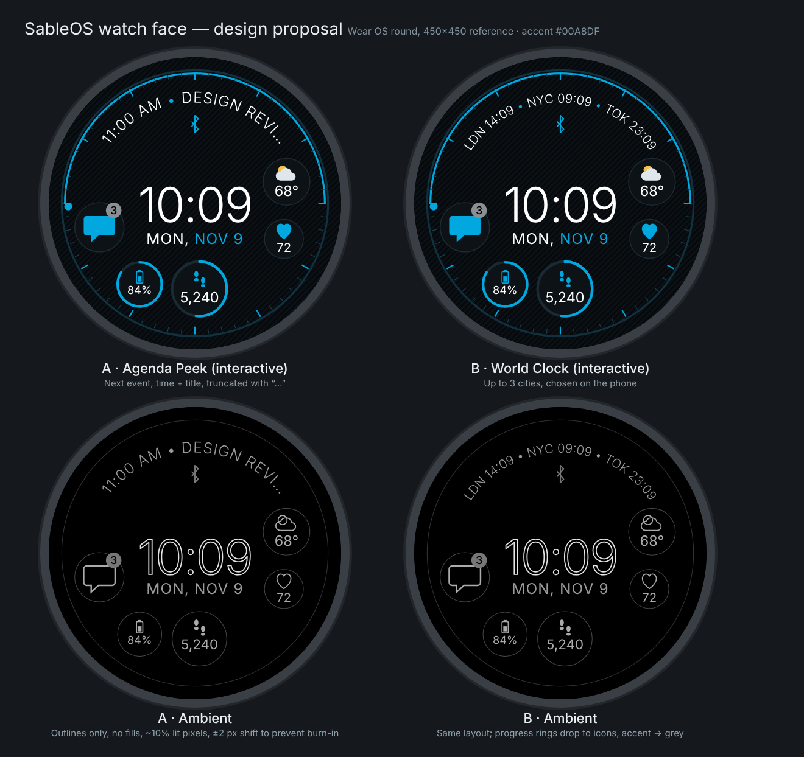
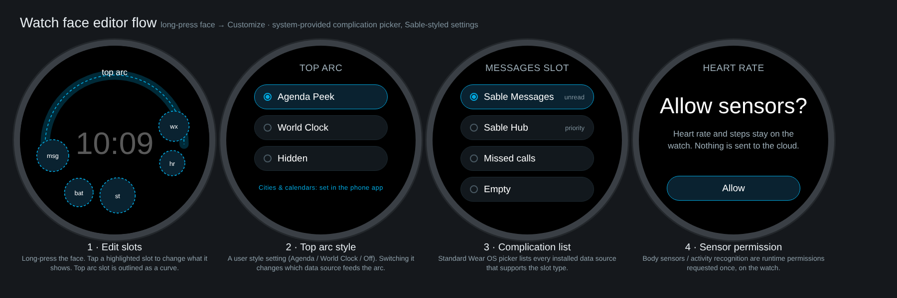
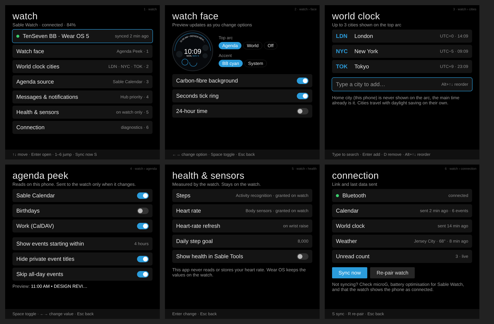

# Design and recommendations

The approved design: a BlackBerry 10-style face with the time and date in the middle, five round complications, and a user-chosen top arc (Agenda Peek or World Clock).

| | |
| --- | --- |
|  |  |

## How it's built

- **The face is Watch Face Format (WFF)**: XML and images, no code. Wear OS draws it, which uses less battery than a face that runs its own drawing code, and it is Google's recommended format for new faces. The top arc uses WFF's curved text (`TextCircular`).
- **Custom data comes from complication sources in the watch app** (Kotlin), since a WFF face can't run code. The first is Sable World Clock.
- **The top arc is one complication slot.** "User choice" is the face editor's slot picker: the default is the system's next calendar event (Agenda Peek); pick **Sable World Clock** for the three cities. Any other long-text source works too.

## Where each part's data comes from

| Element | Source | Needs the phone? |
| --- | --- | --- |
| Time, date, tick ring | The face | No |
| Battery ring | System watch battery source (default) | No |
| Steps ring | System step count source (default) | No |
| Heart rate | The watch maker's heart-rate source, picked in the editor (no system default exists) | No |
| Weather | A weather source on the watch, picked in the editor; later a Sable source fed by Sable Weather | Optional |
| Messages | System unread notification count (default); later Hub priority counts from the phone | Later |
| Top arc: Agenda Peek | System next event (default); later Sable Calendar from the phone | Later |
| Top arc: World Clock | Sable World Clock, computed on the watch | Only to choose cities |

Heart rate and steps stay on the watch. The phone app never reads them.

## Phone builds

The phone app is one codebase with two builds, both with the package name `io.github.aimindseye.sablewatch`:

- **`sable`** for SableOS. It ships in the system image with its permissions granted, reads Sable Calendar, Sable Weather and Hub priority counts directly, and follows the system accent.
- **`generic`** for any Android phone, for example one running TenSeven Launcher. It uses the standard Android calendar and notification-count APIs, asks the user for calendar and notification access, and has its own accent setting.

The watch side is the same for both.

## Pairing with a microG phone

Wear OS pairing and the Data Layer API depend on Google Play services, and the Zinwa Q25 runs SableOS with microG. The Galaxy Watch 7 pairs through Samsung's Galaxy Wearable app, which also needs Play services. Until that is tested, the phone app only has its home screen.

- If pairing and the Data Layer work through microG: the phone sends cities, agenda and counts over the Data Layer.
- If not: a direct Bluetooth LE link between the phone app and the watch app, which needs no Google services.

## Limits

- The arc fits three cities, or about 18 characters of an event title before it is cut with an ellipsis.
- Ambient mode is black with grey outlines only, to save power and avoid burn-in.
- Real BB10 fonts aren't licensed for use; the face uses the watch's system font.
- The Bluetooth-connected icon from the mockup needs WFF v2 or later and is left out of v1 for now.
